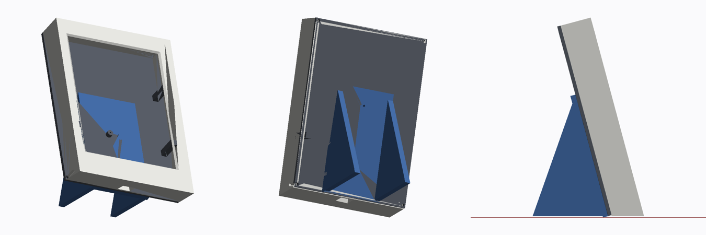

# epaper-immich-frame

A self-updating photo frame: a **Raspberry Pi Pico W** with a **Waveshare 5.65" 7-colour
ACeP e-paper display** (600×448) shows a random photo from an album in your own
[Immich](https://immich.app) server, every hour or once a day.



> **Written by AI.** All code, the case design and this documentation were written by an
> AI coding assistant, directed and tested on real hardware by a human. It works on the
> author's frame; review before you rely on it.

## How it works

```
 Immich album ──API key──▶ frame server ──HTTP (LAN)──▶ Pico W ──SPI──▶ e-paper
                           (Python/Docker,             (wakes up, fetches,
                            converts photos)            refreshes, waits)
```

The Pico is far too small to decode JPEGs and dither them to 7 colours, so a small
server on your home network does the heavy lifting:

1. it picks a random photo from an Immich album (skipping the last 30 it showed),
2. crops it to 600×448 and optionally rotates portrait photos a quarter turn,
3. boosts saturation/contrast and dithers it (Floyd–Steinberg) against the
   **measured** colours of the panel — ACeP colours are much duller than pure RGB,
   and dithering against the real ones gives noticeably more faithful results,
4. serves the result as a ready-to-display 134,400-byte frame (4 bits per pixel).

The Pico W connects to WiFi, downloads the frame, refreshes the panel (~12 s) and
waits as long as the server tells it to (`X-Sleep-Seconds`), so you change the interval
on the server without reflashing. If anything fails the current photo stays up and the
Pico retries in 5 minutes. Your Immich credentials never leave the server.

## Hardware

| Part | Notes |
|---|---|
| Raspberry Pi Pico W | 2.4 GHz WiFi only |
| Waveshare 5.65inch e-Paper Module (F) | 600×448, black/white/green/blue/red/yellow/orange |
| 3D-printed case | optional, see [`case/`](#3d-printed-case) |

### Wiring

| Display | Pico W | Pico pin |
|---|---|---|
| VCC | VSYS (or 3V3) | 39 (36) |
| GND | GND | 38 |
| DIN | GP11 | 15 |
| CLK | GP10 | 14 |
| CS | GP9 | 12 |
| DC | GP8 | 11 |
| RST | GP12 | 16 |
| BUSY | GP13 | 17 |

This is Waveshare's standard Pico pinout (SPI1).

## 1. Immich

1. Create an album, e.g. **Fotolijst**, and add the photos you want on the frame.
2. *Account Settings → API Keys → New API Key*. The server only needs
   `album.read`, `asset.read` and `asset.view`.

## 2. Server

Runs anywhere on your LAN that is always on (a Pi, a NAS, a home server).

**Docker**
```sh
cd server
cp .env.example .env            # fill in IMMICH_URL, IMMICH_API_KEY, FRAME_TOKEN
cp docker-compose.example.yml docker-compose.yml
docker compose up -d --build
```

**Plain Python** (3.10+, only dependency is Pillow)
```sh
cd server
python3 -m venv venv && venv/bin/pip install -r requirements.txt
cp .env.example .env            # the server reads .env next to the script
venv/bin/python fotolijst_server.py
```
A systemd unit is included: [`server/fotolijst.service`](server/fotolijst.service).

**Check it:** open `http://<server>:8080/frame?token=<token>` (downloads a frame), then
`http://<server>:8080/preview.png` shows how that photo will look on the panel.

### Settings (`.env`)

| Variable | Default | |
|---|---|---|
| `IMMICH_URL` | | e.g. `https://photos.example.net` |
| `IMMICH_API_KEY` | | |
| `IMMICH_ALBUM` | `Fotolijst` | album name or id (shared albums work too) |
| `REFRESH_SECONDS` | `3600` | time between photos; `86400` = daily |
| `FRAME_TOKEN` | | if set, `/frame` requires `?token=…` |
| `ORIENTATION` | `auto` | `landscape`: landscape photos only · `portrait`: portrait photos only, rotated for a frame standing upright · `auto`: everything, portrait photos rotated |
| `ROTATION` | `90` | `90` or `270`; flip it if photos come out upside down |
| `SATURATION` / `CONTRAST` / `BRIGHTNESS` | `1.5` / `1.2` / `1.0` | `1.0` = unchanged |
| `WARMTH` | `0.0` | shifts towards red, `0`–`0.15` |
| `PHOTO_DIR` | | serve a local folder instead of Immich (for testing) |
| `PORT` | `8080` | |

## 3. Firmware

Built with [PlatformIO](https://platformio.org) on the
[arduino-pico](https://github.com/earlephilhower/arduino-pico) core.

```sh
cd firmware
pio run
```
Flash: hold **BOOTSEL** while plugging in the Pico and copy
`.pio/build/pico_w/firmware.uf2` to the `RPI-RP2` drive. Once this firmware is running,
`pio run -t upload` can put it into BOOTSEL by itself.

### WiFi and server address: `config.txt`

When plugged into a computer the Pico shows up as a small USB drive with `config.txt`:

```ini
WIFI_SSID=my-network
WIFI_PASS=secret
FRAME_URL=http://192.168.1.10:8080/frame?token=...
```

Edit, save and **eject** the drive: the Pico reloads the settings and fetches a photo
right away. Use the server's IP address rather than a hostname.
(Optional: values in `firmware/src/secrets.h`, see `secrets.example.h`, pre-fill
`config.txt` on first boot.)

Serial log: `/dev/ttyACM0`, 115200 baud.

## 3D-printed case

Portrait, leaning back 15°. Parametric FreeCAD script: [`case/fotolijst_case.py`](case/fotolijst_case.py),
ready-made STLs in [`case/stl/`](case/stl).

| Part | Print orientation | |
|---|---|---|
| `front.stl` | front face down | bezel with chamfered window, walls, foot |
| `back.stl` | outside face down | lid with pads that hold the display, Pico W posts |
| `stand.stl` | base plate down | two fins, screws onto the lid |

No supports needed. Screws (self-tapping): 4× M2.5×10 lid, 2× M2.5×8 stand, 4× M2×5 Pico.
The micro-USB port comes out at the bottom.

> **Measure before printing.** Window position, module thickness and the display's
> mounting depth are taken from Waveshare's specs and a photo, not from calipers. Check
> `PCB_W/PCB_H`, `MODULE_T`, `ACTIVE_X0/ACTIVE_Y0` at the top of the script and regenerate:
> ```sh
> freecad.cmd -c "exec(open('case/fotolijst_case.py').read())"
> ```

The case puts the display in portrait; use `ORIENTATION=portrait` on the server and
pick `ROTATION` so photos come out upright.

## Tools

USB test tools (talk to the firmware over serial, no WiFi needed):

```sh
python3 tools/convert.py photo.jpg --preview out.png      # preview the conversion
python3 tools/convert.py photo.jpg --send /dev/ttyACM0    # show it on the display
python3 tools/calibrate.py show --send /dev/ttyACM0       # colour patches for calibration
```
An image sent over USB pauses the WiFi updates for 10 minutes.

## Notes and lessons learned

- **Colours.** The palette in [`server/epaper.py`](server/epaper.py) was measured from
  a phone photo of the calibration patches, white-balanced on the panel white. Black on
  this panel is a slightly bluish dark grey; contrast is about 12:1.
- **Things that do *not* improve the image** (all measured): forcing another
  temperature/LUT, lowering the PLL frame rate (the OTP LUT overrides it), refreshing
  2–3 times, pre-clearing to black. Pre-clearing with the "clean" colour makes it worse.
  The panel always picks the same waveform at room temperature (11.4 s refresh).
- **Purple border.** The thin purple line around the active area is part of the panel;
  none of the eight border settings (register 0x50) change it.
- **MicroPython** (Waveshare's own driver, identical command sequence) hung on BUSY after
  init on this board; the same sequence works fine in C++. Not investigated further.

Code comments and log messages are in Dutch.

## License

Public domain, see [LICENSE](LICENSE) ([The Unlicense](https://unlicense.org)). Do whatever
you want with it.
