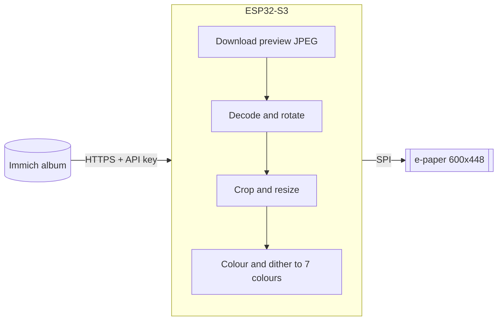

# epaper-immich-frame

A self-updating photo frame: an **ESP32-S3** with a **Waveshare 5.65" 7-colour ACeP
e-paper display** (600×448) shows a random photo from an album in your own
[Immich](https://immich.app) server, every hour or once a day. No extra server needed:
the ESP32 downloads, crops, colour-corrects and dithers the photo itself.

> **Written by AI.** All code and this documentation were written by an
> AI coding assistant, directed and tested on real hardware by a human. It works on the
> author's frame; review before you rely on it.

## How it works



1. The ESP32 picks a random photo from an Immich album (`/api/search/random`, skipping
   the last 30 it showed) and downloads Immich's **preview** JPEG (1440 px by default).
2. It decodes the JPEG at ½ or ¼ scale straight into PSRAM, rotates portrait photos a
   quarter turn if you want, and crops to 600×448 (biased towards the top, so heads stay
   in frame).
3. It boosts saturation/contrast and dithers (Floyd–Steinberg) against the **measured**
   colours of the panel. ACeP colours are much duller than pure RGB, and dithering
   against the real ones gives noticeably more faithful results.
4. It refreshes the panel (~12 s) and waits until the next photo.

Decoding and converting take about 5–7 s on the ESP32-S3; a whole update including WiFi
and HTTPS takes ~20 s. Certificates are verified with the built-in CA bundle.

## Hardware

| Part | Notes |
|---|---|
| ESP32-S3 dev board, **N16R8** | 16 MB flash, 8 MB octal PSRAM; e.g. an ESP32-S3-DevKitC-1 clone with two USB-C ports |
| Waveshare 5.65inch e-Paper Module (F) | 600×448, black/white/green/blue/red/yellow/orange |

### Dimensions

Official drawings from Waveshare:

- [Module outline](https://www.waveshare.com/img/devkit/LCD/5.65inch-e-Paper-Module-F/5.65inch-e-Paper-Module-F-details-size.jpg)
  (PCB with panel, mounting holes, pin header)
- [Panel specification (PDF)](https://files.waveshare.com/upload/7/7a/5.65inch_e-Paper_%28F%29_Sepecification.pdf),
  page 5: mechanical drawing of the bare panel, including the FPC
- [Product page](https://www.waveshare.com/5.65inch-e-paper-module-f.htm) and
  [wiki](https://www.waveshare.com/wiki/5.65inch_e-Paper_Module_(F)_Manual)

| | mm |
|---|---|
| Module (PCB) | 138.5 × 100.5 |
| Mounting holes | 4, centres 2.5 from the PCB edges (so 133.5 × 95.5 apart) |
| Pin header | 8 pins, 2.54 pitch, 3.0 from the edge, centred on the short side |
| Panel glass | 125.4 × 99.5 × 0.91 |
| Active area | 114.9 × 85.8 (600 × 448 px, 0.1915 pitch) |

No 3D/STEP model is published.

### Wiring

| Display | ESP32-S3 |
|---|---|
| VCC | **3V3** (not 5V: the module takes its logic level from VCC) |
| GND | GND |
| DIN | GPIO 11 |
| CLK | GPIO 12 |
| CS | GPIO 10 |
| DC | GPIO 9 |
| RST | GPIO 8 |
| BUSY | GPIO 7 |

DIN/CLK/CS are the S3's native FSPI pins. On a DevKitC-1 layout all of these sit next to
each other on one header. Avoid GPIO 26–32 (flash), 35–37 (octal PSRAM), 0/3/45/46
(strapping), 19/20 (USB) and 43/44 (UART).

### The two USB ports

| Port | Used for |
|---|---|
| **COM** / UART (USB-serial chip) | flashing and the serial log |
| **USB** (native) | the `config.txt` drive, a second serial log, sending test images; also power |

In normal use only the native **USB** port needs a cable.

## 1. Immich

1. Create an album, e.g. **Fotolijst**, and add the photos you want on the frame.
2. *Account Settings → API Keys → New API Key* with only `album.read`, `asset.read` and
   `asset.view`.
3. Leave *Administration → Image Settings → Preview* on **JPEG** (the default). WebP
   previews can't be decoded on the ESP32.

## 2. Firmware

Built with [PlatformIO](https://platformio.org) on Arduino-ESP32 3.x. See
[`firmware/README.md`](firmware/README.md) for what each source file does.

```sh
cd firmware
pio run -t upload --upload-port /dev/ttyACM0     # the COM port
```

### Settings: `config.txt`

Plug the native **USB** port into a computer: the frame shows up as a small drive
**FOTOLIJST** with `config.txt`. Edit and save; after two seconds of quiet the frame
stores the settings in flash, applies them and fetches a new photo. No need to eject.

| Key | Default | |
|---|---|---|
| `WIFI_SSID`, `WIFI_PASS` | | 2.4 GHz only |
| `IMMICH_URL` | | e.g. `https://photos.example.net` |
| `IMMICH_API_KEY` | | |
| `IMMICH_ALBUM` | `Fotolijst` | album name or id (shared albums work too) |
| `REFRESH_SECONDS` | `3600` | `86400` = daily |
| `ORIENTATION` | `auto` | `landscape`: landscape photos only · `portrait`: portrait photos only, rotated for a frame standing upright · `auto`: everything, portrait photos rotated |
| `ROTATION` | `90` | `90` or `270`; flip it if photos come out upside down |
| `SATURATION` / `CONTRAST` / `BRIGHTNESS` | `1.5` / `1.2` / `1.0` | `1.0` = unchanged |
| `WARMTH` | `0.0` | shifts towards red, `0`–`0.15` |

The drive is a 512 KB FAT image kept in PSRAM and mirrored to LittleFS, so a pulled
cable doesn't lose your edits once the frame has stored them.

### Serial commands

On either port (115200 baud): `NOW` fetches a new photo immediately.
The log never prints the WiFi password or API key.

## Tools

Send images over the native USB port (no WiFi needed). An image sent this way pauses
the automatic updates for 10 minutes.

```sh
PORT=/dev/serial/by-id/usb-Espressif_Systems_Fotolijst_*-if01
python3 tools/convert.py photo.jpg --preview out.png   # preview the conversion
python3 tools/convert.py photo.jpg --send $PORT        # show it on the display
python3 tools/calibrate.py show --send $PORT           # colour patches for calibration
```

`firmware/test/host/` builds the ESP32 image pipeline on a PC
(`test/host/build.sh`, after `pio pkg install`) to compare it with the Python version in `tools/epaper.py`.

## Notes and lessons learned

- **Colours.** The palette in [`tools/epaper.py`](tools/epaper.py) and
  [`firmware/src/imaging.cpp`](firmware/src/imaging.cpp) was measured from a phone
  photo of the calibration patches, white-balanced on the panel white. Black on this
  panel is a slightly bluish dark grey; contrast is about 12:1.
- **Things that do *not* improve the image** (all measured): forcing another
  temperature/LUT, lowering the PLL frame rate (the OTP LUT overrides it), refreshing
  2–3 times, pre-clearing to black. Pre-clearing with the "clean" colour makes it worse.
  The panel always picks the same waveform at room temperature (11.4 s refresh).
- **Purple border.** The thin purple line around the active area is part of the panel;
  none of the eight border settings (register 0x50) change it.
- **JPEGDEC channel order.** Depending on the internal code path (plain C, SSE on a PC,
  ESP32-S3 SIMD) the decoder's RGB8888 output is R,G,B or B,G,R. The firmware decodes a
  tiny red JPEG at each scale once to find out.
- **History.** The first version ran on a Raspberry Pi Pico W, which is too small to
  decode photos and needed a separate conversion server. MicroPython (Waveshare's own
  driver) hung on BUSY on that board; C++ worked.

Code comments and log messages are in Dutch.

## License

Public domain, see [LICENSE](LICENSE) ([The Unlicense](https://unlicense.org)). Do whatever
you want with it.
