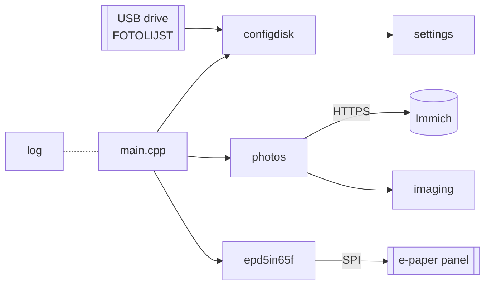
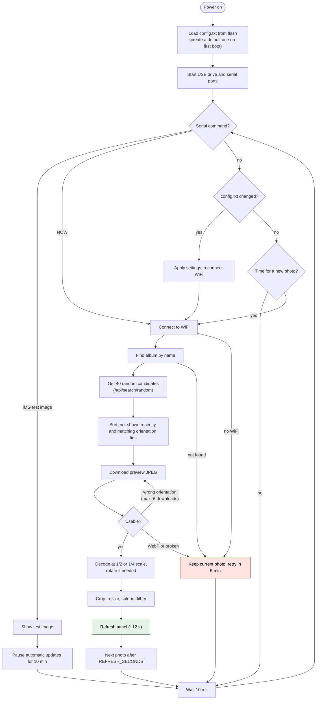

# Firmware

ESP32-S3 firmware for the e-paper photo frame (PlatformIO, Arduino-ESP32 3.x).
Build and flash instructions are in the [main README](../README.md).

## How the pieces fit together

`log` is used by all modules.

Every `REFRESH_SECONDS` (or right after `config.txt` changes, or on the `NOW` command)
`main.cpp` connects to WiFi, asks `photos` for a new 134,400-byte frame and hands it to
`epd5in65f`. If something fails, the current photo stays up and it retries in 5 minutes.

## Main loop

## Files

### `src/`

| File | What it does |
|---|---|
| `main.cpp` | Entry point. `setup()` loads the settings, starts the USB drive and the panel; `loop()` handles serial commands (`NOW`, `IMG0/1/2` test images), watches `config.txt` for changes, and runs the fetch → show cycle on the refresh interval. Also owns the WiFi connection. |
| `settings.h/.cpp` | The `Settings` struct (WiFi, Immich, interval, orientation, image tuning), the `KEY=value` parser for `config.txt` (handles comments, quotes, BOM, Windows line endings) and the template for a fresh `config.txt`. |
| `configdisk.h/.cpp` | The **FOTOLIJST** USB drive. A 512 KB FAT image lives in PSRAM and is exposed over the native USB port (TinyUSB mass storage). Two seconds after the computer stops writing, the image is saved to LittleFS and `config.txt` is re-read through FatFs from a snapshot copy, so the host and the firmware never use the same buffer at once. Formats a new drive with a default `config.txt` on first boot. |
| `photos.h/.cpp` | Talks to Immich: finds the album by name (own and shared albums), gets candidates from `/api/search/random` (falls back to the album's asset list on older Immich versions), prefers photos it hasn't shown recently and that match `ORIENTATION`, downloads `/api/assets/{id}/thumbnail?size=preview`, and runs it through `imaging`. HTTPS uses the built-in CA bundle. Rejects WebP previews with a clear message. |
| `imaging.h/.cpp` | The image pipeline, platform-independent so it also builds on a PC. Decodes the JPEG with JPEGDEC at ½, ¼ or ⅛ scale (as small as possible while still covering 600×448), rotates while decoding, crops like Pillow's `ImageOps.fit`, downsizes by area averaging, applies saturation/contrast/brightness/warmth with Pillow's formulas, and Floyd–Steinberg-dithers row by row against the **measured** panel palette. Output is the packed 4-bit frame. |
| `red_jpeg.h` | A tiny solid-red JPEG. `imaging` decodes it once per scale to find out whether JPEGDEC delivers R,G,B or B,G,R on that code path. |
| `epd5in65f.h/.cpp` | Driver for the Waveshare 5.65" 7-colour panel: pin definitions, reset, the init sequence from Waveshare's reference driver, streaming a frame row by row, refresh with BUSY timeouts, and deep sleep. `Options` exposes the temperature/PLL/border registers used for the experiments in the main README. |
| `log.h/.cpp` | `logf()`: printf-style logging to the COM port and, when a terminal is open on it, the native USB serial port. Defines the `USBSerial` object. |

### Other

| File | What it does |
|---|---|
| `platformio.ini` | Board config for the ESP32-S3 N16R8 (octal PSRAM, 16 MB flash, LittleFS), TinyUSB mode for the native port, and the flags that keep JPEGDEC on its plain C path (its S3 SIMD code needs esp-dsp headers that aren't on the include path). |
| `test/host/imaging_test.cpp` | Runs `imaging` on a PC: decodes a JPEG, writes a preview (PPM) and the raw frame. Used to compare the firmware's output with `tools/epaper.py`. |
| `test/host/build.sh` | Builds that test with `g++` against the JPEGDEC sources PlatformIO downloaded (`pio pkg install` first). |

## Memory use

| What | Where | Size |
|---|---|---|
| Downloaded JPEG | PSRAM | ~0.2–0.5 MB |
| Decoded photo (e.g. 960×720 RGB) | PSRAM | ~2 MB |
| Resized photo before dithering | PSRAM | 0.8 MB |
| Dithering error rows | internal RAM | 14 KB |
| Frame for the panel | PSRAM | 131 KB |
| Config drive + snapshot | PSRAM | 2 × 512 KB |
